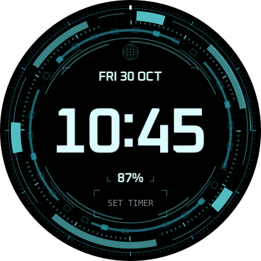

# JARVIS

A cyan concentric-instrument face inspired by the user's `JARVIS.png`, reauthored for the Galaxy Watch7 40 mm / Wear OS 6. Large stationary time sits inside a turbine of asymmetric sectors, fine calibration marks and counter-rotating index windows. A small wireframe sphere, dark peripheral grid and restrained core light recall the reference without placing dense graphics behind the clock.

**0.1.0, build 1**, package `com.thedungeons2077.realtime.jarvis`, published tag `jarvis-v0.1.0`, source `e23a4839960d190be548d3006ed0226d2e39d00c`. On 2026-10-30 the user accepted the design and confirmed motion and phone customization feel as seamless as NEXUS. Uses the [accepted NEXUS 0.1.2 checkpoint](../../docs/CHECKPOINT-NEXUS-0.1.2.md) for rendering/editor architecture. Existing faces remain unchanged.



## Design and controls

| Setting | Choices; default in bold |
|---|---|
| Colours | **CYAN**, ICE, AMBER, PHOSPHOR, BLOOD, VIOLET |
| Clock font | **OXANIUM**, RAJDHANI, TECHMONO, SEGMENT |
| Clock size | SMALL, **MEDIUM**, LARGE |
| Clock glow | OFF, **LOW**, HIGH |
| Motion speed | STILL, **SLOW 0.5×**, STANDARD 1×, FAST 2× |
| Individual effects | Outer turbine, inner index, radar sweep, core light, seconds mark; **all on** |

The clock is centred at (216,216) and follows the watch's 12/24-hour preference. Date is above, battery percentage below, and an editable Timer/shortcut slot is at the bottom. Battery warns at ≤15%. Provider content and tap action identify the actual shortcut; SET TIMER appears while empty. Timer availability must be checked on the watch, never replaced silently with Alarm. No branding or invented telemetry is drawn.

At default Slow, the outer turbine turns clockwise every **60 s**, inner index counter-clockwise every **96 s**, radar sweep every **48 s**, and core light breathes every **16 s**. Seconds always takes a real minute. All motion uses live clock sources; there are no restartable loops, gyro effects or runtime blur. OFF returns rings/light to their reference pose and removes sweep/seconds overlays; Still removes all decorative clock dependencies. Ambient is dim static time only on black.

## Checkpoint implementation

Eight authored SVG masks are cropped and packed through the shared `RasterOptimizer`. Static grid/bezel imagery merges in painter order; single-image carriers use direct transforms where their pivot is valid inside the crop. The two small orbiting overlays retain a group to preserve their external pivot. Glow is baked into alpha masks and glyphs.

Flat editor declarations, captioned option icons, accessibility labels and Condition branches follow NEXUS. Interactive clocks/readouts are shared across palettes with configuration-only typed RGB colours; decoration/ambient retain literal colours. The 152,880-byte definition is smaller than NEXUS's 250,138-byte checkpoint, with 60 rather than 102 clock declarations and 16–18 rather than 16–20 selected drawing parts. These counts do not guarantee identical frame delivery or editor latency. The user has confirmed comparable perceived motion and phone editor responsiveness; retain the detailed checklist for future regressions.

The reference at `C:\Users\57298327\Desktop\DL\JARVIS.png` is read locally for visual comparison only. It is neither committed nor included in the APK. The gallery aligns its central instrument with crop `(80,0,710,710)`; this is an inspiration comparison, not a claim of pixel reproduction.

## Build and review

```bash
node tools/compose/src/build.ts --face jarvis
node tools/check/jarvis.ts
bash scripts/release-wear.sh --face jarvis --verify-only
bash scripts/release-diagnostics.sh --verify-only
```

Open `out/previews/jarvis/index.html` directly. It includes the local reference when available, palettes, fonts, sizes, glow levels, speeds, effect-off states, motion poses, battery warning, 12-hour/midnight, provider examples and ambient. Preview animation demonstrates geometry, not measured watch FPS. See [verification](VERIFICATION.md).

## Phone installation and acceptance

1. Update the phone to **real_time installer 0.7.3**; older versions intentionally reject JARVIS. Install over the existing helper to preserve pairing. No diagnostics or new permissions are added.
2. In the helper choose `real_time-jarvis-v0.1.0.apk`, confirm JARVIS/build 1, then INSTALL TO WATCH. Add JARVIS in the watch's face picker. Turn wireless debugging off afterwards.
3. Compare responsiveness against NEXUS 0.1.2 with the same brightness/power conditions. Check default Slow/all effects, every speed and optional effect; motion must resume after wake, face switching and editor exit.
4. Open Galaxy Wearable Customize repeatedly; change every category, Save/reopen and Cancel. Confirm icons, selection feedback, persistence and agreement with on-watch editing. Check time/date/battery colours in every palette and font/glow/size combinations.
5. Verify readable 12/24-hour time, date rollover, battery/warning, Timer provider display/tap and minimal ambient. Record unavailable providers rather than marking them accepted.

Record exact versions/firmware and user observations. Resolve regressions before calling this new face as seamless as the accepted checkpoint; no reset or PC-to-watch ADB connection is part of installation or acceptance.
