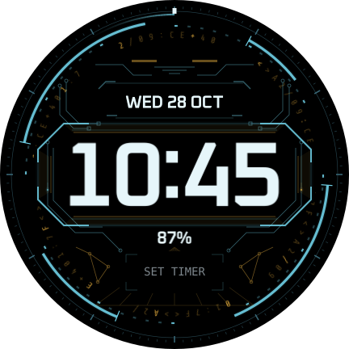

# NEXUS

An original command-deck face for the Galaxy Watch7 40 mm, Wear OS 6. NEXUS combines the family's visual ideas around a large, stationary clock rather than reproducing a desktop wallpaper.

Version **0.1.2, build 3** is published and is the user-accepted responsiveness checkpoint. Package: `com.thedungeons2077.realtime.nexus`; release: `nexus-v0.1.2`. On 2026-10-29 the user confirmed the Galaxy Wearable Customize timeout was resolved: “That fixed it, it's perfect now.” Future faces must target the same seamless experience; see [the checkpoint](../../docs/CHECKPOINT-NEXUS-0.1.2.md).



## Design lineage

| Source | NEXUS interpretation |
|---|---|
| HALO | Cyan/amber default, separated instrument arcs, fine bezel divisions and precise corner marks |
| REDLINE | Large centred time, asymmetric mechanical rotation, dark HUD, stationary readouts and working editor architecture |
| CIPHER | One sparse counter-rotating terminal-code orbit, bitmap fonts and one image per moving piece |
| Cyberdeck DATAFLOW / NEURALNET | Etched circuit buses, two travelling signals, small connected nodes |
| Cyberdeck PRISM / VELOCITY | Smoked bevels, two-tone edge light and angular console geometry |
| Cyberdeck HORIZON / SUNSET | A quiet lower perspective fan and short stacked horizon marks |
| Cyberdeck MEGACITY | Layered structural depth and restrained illuminated edges, without a miniature skyline behind the time |

The source review used `real_time` at `68c6449` and `cyberdeck_terminal` at `00e94f7` (0.23.1). Every artwork mask was authored for the watch in `tools/compose/faces/nexus/masks.ts`. No wallpaper shader, background simulation or desktop asset was ported into the APK.

The clock stays centred at (216,216), with tight glyph advances and no inserted tracking. The date is above it, the battery percentage below it, and one editable Timer/shortcut tile at the bottom. No branding, fake telemetry or decorative status claims occupy the face. SEGMENT intentionally retains fixed LCD cells and faint unlit segments, as on the other faces.

## Controls

| Setting | Choices; default in bold |
|---|---|
| Colours | **FUSION**, PHOSPHOR, AMBER, ICE, NEON, BLOOD, SYNTH, OUTRUN |
| Font | **OXANIUM**, RAJDHANI, TECHMONO, VT323, DOT, SEGMENT |
| Size | SMALL, **MEDIUM**, LARGE |
| Clock glow | OFF, **LOW**, HIGH |
| Motion speed | STILL, **SLOW 0.5×**, STANDARD 1×, FAST 2× |
| Effects | Mechanical ring, code orbit, circuit signals, bezel sweep, glass light, seconds mark; **all on** |

Both editors get captioned PNG tiles and accessibility labels. Palette tiles show both hues. IDs are stable; Conditions select scene branches. Decoration and ambient use literal colours; shared interactive text uses configuration-only WFF 4 RGB transforms, with no indexed theme-colour references. The readout font follows the clock. Battery turns to the palette's warning colour at 15% or below. Time follows the watch's 12/24-hour setting.

Select Timer once in the complication editor. Until configured, the tile says SET TIMER. Afterwards it shows the selected provider's actual text, image or progress and uses that provider's tap action. Timer availability and tap behaviour need watch acceptance; Alarm is never substituted.

## Motion and cost

At default Slow, the mechanical ring turns clockwise every 48 s, the code orbit counter-clockwise every 192 s, and the outer sweep every 36 s. Two 6×14-pixel circuit signals complete a pass every 16 s. The bevel light breathes every 32 s. Seconds always completes a real minute, regardless of decorative speed.

Motion reads the live clock, without a repeating Animation, sensor input or one-second startup target. Periods divide the day at every speed, avoiding a phase jump at midnight. Signal opacity reaches zero at both ends before wrapping. Rings freeze at their reference pose when disabled; sweep, signals and seconds disappear. STILL selects the same static branches, with no decorative clock dependencies.

The eleven authored SVG masks remain the source artwork. In 0.1.1 a build-time pass crops their transparent borders and merges the four static console images into one coloured layer per palette. Moving masks remain shared across palettes; two signal instances reuse one tiny mask. Opacity moves onto individual images and valid centred rotations use direct image transforms. Clock glow is baked into unchanged glyphs. See the [optimization record](../../OPTIMIZATION.md#nexus-011-optimization-candidate) for structural and pixel-comparison results. There is no runtime blur, procedural texture generation, per-character ring animation or full-screen image sequence. This bounds rendering work; it does **not** establish actual frame rate or battery savings.

Ambient is the selected font's crisp, dim static time on black, with all decoration/readouts/shortcut hidden. Normal use assumes AOD off.

## Build and review

```bash
node tools/compose/src/build.ts --face nexus
node tools/check/nexus.ts
node tools/check/nexus-optimization.ts
python3 -I tools/check/nexus-editor.py
bash scripts/release-wear.sh --face nexus --verify-only
bash scripts/release-diagnostics.sh --verify-only
```

Open `out/previews/nexus/index.html` directly. It includes every palette/font/size/glow, effect-off states, several motion poses, low battery, midnight, 12-hour time, Timer states and ambient per font. The short animated sample shows geometry, not measured watch delivery; its replay boundary is not a watch animation wrap.

Local verification results are in [VERIFICATION.md](VERIFICATION.md). Existing HALO, REDLINE and CIPHER resources stay unchanged.

## Phone installation and acceptance

Use **real_time installer 0.7.2 or later** on the phone: older versions intentionally reject unknown NEXUS packages. Choose `real_time-nexus-v0.1.2.apk`, check the NEXUS/version label and tap INSTALL TO WATCH. This updates the existing face without uninstalling or re-pairing; setting IDs remain stable. See [phone instructions](../../diagnostics/phone/README.md); the PC never connects to the watch.

The user confirmed 0.1.2 fixed the phone Customize timeout and accepted the experience. Reliable on-watch editing was previously reported. Individual checklist results beyond that report remain unspecified. For future changes, use this regression sequence: open Galaxy Wearable Customize three times, change/save Fusion → Blood → Outrun, and close/reopen to verify persistence and agreement with the watch. Check clock/date/battery colours specifically because their tinting implementation changed. Then check font/glow/size and motion after editor exit and a face switch. Record the exact installed face version, phone app version, watch firmware and approximate opening time. No reset or re-pairing is part of this test. Detailed acceptance remains:

- First application and both editor previews render correctly; time/date/battery remain readable on the 40 mm screen.
- Every colour, font, size, glow, speed and effect works in Galaxy Wearable and on the watch; Save persists, Cancel preserves the previous selection, and both editors agree.
- Motion resumes after switching faces, wake/unlock, editor Save/Cancel and restart; compare Slow and Standard, especially the slow code orbit.
- Date rolls over, 12/24-hour preference is respected and low-battery warning is correct.
- Timer selection displays the chosen provider accurately and tapping opens the right app.
- Ambient shows only dim time; review normal AOD-off use and report perceived smoothness and battery experience.

Record device/firmware, settings and observations in [OPTIMIZATION.md](../../OPTIMIZATION.md). A local validator pass is not device acceptance.
