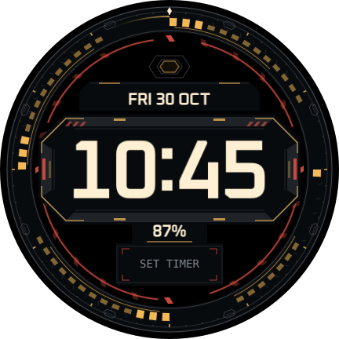

# REACTOR

An original industrial HUD for the Galaxy Watch7 40 mm / Wear OS 6: dark titanium containment plates, amber energy cells, restrained red tension latches and a large fixed clock. Two counter-rotating rings pass behind an opaque armoured bridge; a small upper hexagonal core and shoulder lights breathe quietly. No moving decoration crosses the live information.

**0.1.0, build 1**, package `com.thedungeons2077.realtime.reactor`, published tag `reactor-v0.1.0`. On 2026-10-30 the user confirmed: **“It looks and runs amazing! Continue in the direction you are heading!”** Design and perceived running performance are accepted; see the [exact checkpoint and evidence scope](../../docs/CHECKPOINT-REACTOR-0.1.0.md). Rendering and editor architecture follow the [accepted NEXUS checkpoint](../../docs/CHECKPOINT-NEXUS-0.1.2.md) and user-accepted JARVIS. Existing faces remain unchanged.



## Design and controls

| Setting | Choices; default in bold |
|---|---|
| Colours | **EMBER**, ICE, PHOSPHOR, BLOOD, VIOLET, STEEL |
| Clock font | **OXANIUM**, RAJDHANI, TECHMONO, SEGMENT |
| Clock size | SMALL, **MEDIUM**, LARGE |
| Clock glow | OFF, **LOW**, HIGH |
| Motion speed | STILL, **SLOW 0.5×**, STANDARD 1×, FAST 2× |
| Independent effects | Energy rotor, containment ring, charge sweep, core pulse, seconds mark; **all on** |

All palettes retain neutral titanium hardware. Ember uses amber energy and red accents; alternative palettes change energy, secondary accents and text. Time remains centred at (216,216), following the watch's 12/24-hour setting. Date sits above, battery percentage below, with a warning at ≤15%. The lower editable complication shows SET TIMER while empty and actual selected-provider content/tap action after setup. Timer availability requires a watch check; no Alarm substitution or guessed launch target is used.

At default Slow, the energy rotor turns clockwise every **80 s**, containment ring counter-clockwise every **120 s**, charge sweep every **60 s**, and core pulse every **24 s**. Seconds always completes a real minute. Periods divide the day at every speed; live-clock expressions resume without waiting for an animation loop. OFF selects reference poses and removes sweep/seconds overlays. Still removes decorative time dependencies; live time/readouts continue. Ambient is static dim time on black.

## Rendering and editor cost

Twelve original SVG masks contain the plates, fasteners, vent cuts, bevels and energy strokes. All glow/material detail is baked at build time. The shared `RasterOptimizer` crops transparent borders, merges adjacent static layers in painter order, and moves transforms directly onto images when pivots permit. Two orbiting overlays keep groups for their external pivots.

The selected default scene has **7 decorative images**, 596,710 declared image-rectangle pixels and **16–18 drawing parts** when all complication-type branches are conservatively counted. The WFF definition is **152,284 bytes**, 2,156 elements and 60 clock declarations. These are smaller structural costs than NEXUS's accepted checkpoint, not a measured frame-rate or battery gain.

Flat configurations, captioned icons, accessible labels and Condition branches use the shared editor catalogue. Interactive text is shared across palettes with configuration-only RGB colour selection; decoration and ambient use explicit literal colours. There are no indexed theme-colour lookups or nested native scene selectors. The face contains no executable code or permissions.

## Build and preview

```bash
node tools/compose/src/build.ts --face reactor
node tools/check/reactor.ts
bash scripts/release-wear.sh --face reactor --verify-only
bash scripts/release-diagnostics.sh --verify-only
```

Open `out/previews/reactor/index.html` directly. It includes every palette/font/size/glow/speed, optional-effect OFF states, all-off, motion poses, low battery, 12-hour/midnight, provider examples and ambient. The animated preview shows the intended path, not delivered watch FPS. See [verification](VERIFICATION.md).

## Phone installation and acceptance

1. Update the phone to **real_time installer 0.7.4**, installing over the existing helper to preserve pairing. Older versions intentionally reject the new REACTOR package.
2. Choose `real_time-reactor-v0.1.0.apk`, confirm REACTOR/build 1, then INSTALL TO WATCH. Add REACTOR in the watch's face picker. Turn wireless debugging off afterwards.
3. Compare default Slow/all effects with accepted NEXUS and JARVIS under matching brightness/power conditions. Check every speed and individual effect; motion must resume after wake, face switches and editor exit.
4. Repeatedly open Galaxy Wearable Customize; verify icons, changes, Save/reopen, Cancel and agreement with on-watch editing. Check clock/date/battery colours, fonts, sizes and glow.
5. Check readable 12/24-hour time, midnight/date rollover, battery warning, provider content/tap and minimal ambient. Record unavailable Timer support explicitly.

The user's general design/performance acceptance is recorded; the detailed checklist above remains available for unreported behaviours and future regression checks. Record exact versions, firmware and observations when supplied. No reset, re-pairing, PC-to-watch connection or added diagnostics is part of this workflow.
