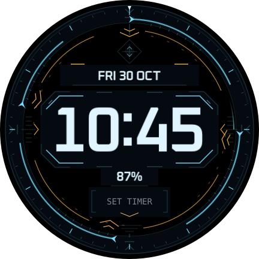

# VECTOR

An original flight-instrument HUD for the Galaxy Watch7 40 mm / Wear OS 6. Ice-blue course rails, amber vector chevrons, open wing brackets and a small diamond reticle surround large fixed time. Navigation marks are decorative; there is no simulated heading, sensor or aircraft telemetry.

**0.1.0, build 1**, independent package `com.thedungeons2077.realtime.vector`, proposed tag `vector-v0.1.0`. Local candidate; publication and device acceptance pending. It follows the accepted [REACTOR design/performance direction](../../docs/CHECKPOINT-REACTOR-0.1.0.md) and [NEXUS editor architecture](../../docs/CHECKPOINT-NEXUS-0.1.2.md). Existing face sources and generated resources remain unchanged.



## Design and controls

| Setting | Choices; default in bold |
|---|---|
| Colours | **NAV**, ICE, PHOSPHOR, EMBER, VIOLET, MONO |
| Clock font | **OXANIUM**, RAJDHANI, TECHMONO, SEGMENT |
| Clock size | SMALL, **MEDIUM**, LARGE |
| Clock glow | OFF, **LOW**, HIGH |
| Motion speed | STILL, **SLOW 0.5×**, STANDARD 1×, FAST 2× |
| Independent effects | Course ring, vector ring, orbit sweep, reticle pulse, seconds mark; **all on** |

Time stays centred at (216,216) and follows the watch's 12/24-hour setting. Date sits above; battery percentage below changes to a warning colour at ≤15%. Thin opaque information wells protect these readouts from moving artwork. The editable shortcut displays SET TIMER when empty and the actual selected provider's content/tap action after configuration. Timer availability needs a device check; Alarm is never substituted.

At default Slow, the course ring turns clockwise every **120 s**, vector ring counter-clockwise every **180 s**, orbit sweep every **48 s**, and reticle pulse every **20 s**. The seconds index completes a real minute independently of decorative speed. All moving periods divide a day, avoiding a midnight phase jump. Live-clock expressions resume when the renderer resumes. OFF selects static reference poses and removes sweep/seconds overlays; Still removes decorative time dependencies. Ambient is only dim static time on black.

## Rendering and customization

Twelve original SVG masks supply the artwork; narrow glow shoulders are baked into image pixels. The shared raster optimizer crops transparent borders, combines adjacent static layers in painter order and uses direct image transforms when valid. Only two orbiting overlays retain groups for external pivots. No runtime blur, shader or frame-sequence decoration is used.

Default decoration resolves to **7 images / 591,327 declared rectangle pixels**, with **16–18 selected drawing parts** including possible complication branches. The compact editor definition is **153,281 bytes**, 2,160 elements and 60 clock declarations. These structural counts are not delivered FPS, editor latency or battery measurements.

Both editors receive flat configuration metadata, captioned option icons, accessible labels, stable IDs and Condition-selected scene branches. Interactive text is shared across palettes using configuration-only explicit RGB selection; decoration/ambient retain literal colours. No nested native selectors or indexed theme references are used. The face has no executable code or permissions.

## Build and preview

```bash
node tools/compose/src/build.ts --face vector
node tools/check/vector.ts
bash scripts/release-wear.sh --face vector --verify-only
bash scripts/release-diagnostics.sh --verify-only
```

Open `out/previews/vector/index.html` directly. The gallery includes all palettes, fonts, sizes, glow/speed options, each effect off, all-off, motion poses, low battery, midnight/12-hour, example provider content and all palette/font ambient combinations. The motion sample illustrates the path, not measured watch FPS. See [verification](VERIFICATION.md).

## Phone installation and acceptance

1. Update the phone to **installer 0.7.5** over the existing helper to retain pairing. Earlier versions intentionally reject VECTOR's new package.
2. Choose `real_time-vector-v0.1.0.apk`, confirm VECTOR/build 1 and tap INSTALL TO WATCH. Select VECTOR in the watch's face picker. Turn wireless debugging off afterwards.
3. Compare default Slow/all effects with accepted REACTOR/NEXUS under similar brightness and power conditions. Check every speed and independent effect, then wake, switch faces and leave/re-enter the editor. Motion must resume.
4. Repeatedly open Galaxy Wearable Customize. Check every captioned choice, preview change, Save/reopen and Cancel, then on-watch editing and persistence in both editors.
5. Check 12/24-hour time, date rollover, battery warning, readability at every font/size, provider content/tap and static ambient. Record unavailable Timer support explicitly.

Record firmware, phone companion version, selected settings and observed behaviour when supplied. Local validation cannot establish a seamless device experience. No reset, re-pairing, watch-PC connection or added diagnostics is required.
